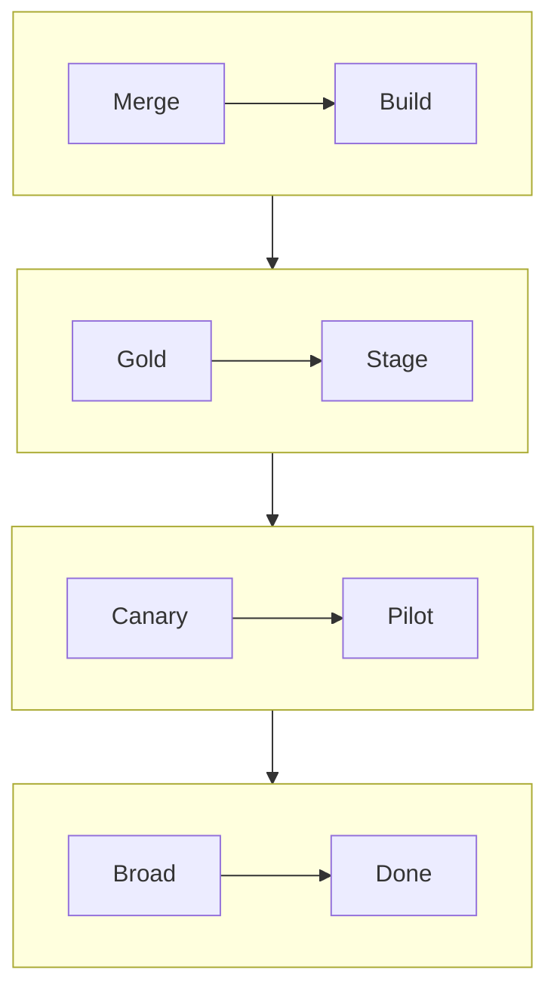
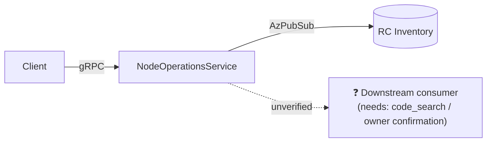

# Diagrams — Types, When to Use, and Accuracy Rules

This reference tells the tech-lead skill **which diagram to draw for which situation**, and **how to keep diagrams truthful**. Prefer Mermaid (renders in ADO/GitHub Markdown); use Excalidraw/PNG only when a freeform sketch is genuinely needed.

---

## Golden rules (non-negotiable)

1. **Never hallucinate.** Every box, edge, actor, lifeline, table, column, and label must correspond to something you actually verified (a file, class, config value, metric, table, PR, or an explicit user statement). If it isn't backed, it doesn't go in the diagram.
2. **Call out missing information.** When a part of the picture is unknown, do **not** guess. Represent the gap explicitly — e.g. a node labeled `❓ Unknown: <what> (needs: <source>)`, a dashed edge labeled `unverified`, or a note under the diagram: *"Not shown: X — no evidence found in <searched sources>."*
3. **Cite the basis.** Directly beneath each diagram, add a one-line **"Backed by:"** list of the sources (`path:line`, Kusto table, PR, dashboard, user input) the diagram is built from.
4. **Match diagram type to intent — but default to flowchart.** A wrong diagram type misleads even when every element is correct. **Unless the prompt explicitly asks for a specific type (sequence, state, ERD, Gantt, C4, etc.), use a `flowchart`** with the standard conventions here (semantic colors + full-width bottom summary caption). It is the default for system-design and any unspecified diagram request. Only switch to another type when the user names it or when the intent genuinely can't be expressed as a flowchart (then say why). Use the selection guide below when a switch is warranted.
5. **Keep it legible.** One concern per diagram. If it needs a legend the size of the diagram, split it. Prefer 5–15 nodes; decompose larger systems into layered diagrams.
   - **Exception — single-diagram requests:** when the user asks for "a diagram", deliver **one consolidated diagram**, not several. Fold detail inline using nested blocks (`par`/`opt`/`loop` in sequence diagrams, `subgraph` + `direction` in flowcharts) rather than emitting a second diagram. Only split when the user explicitly asks for multiple, or when a single valid diagram is genuinely impossible — and then say why.
6. **Distinguish current vs. proposed.** If a diagram mixes existing and proposed state, visually separate them (subgraph `Existing` vs `Proposed`, or a solid vs dashed convention stated in a legend).
7. **No invented quantities.** Numbers on a diagram (latencies, counts, RPS, memory) must come from measured telemetry or config, with the source cited — otherwise omit them or mark `TBD (measure in <task>)`.
8. **Color by role, consistently.** Give each *category* of element (service step, data store, async/messaging, decision/health gate, external dependency, terminal state, unverified) one fixed color from the palette below — same meaning across every diagram. Never color decoratively or per-node at random. Any diagram that uses color needs a one-line legend (or the shared palette names).

---

## Quick selection guide

> **Default:** for system-design docs and any request that doesn't name a diagram type, use a **`flowchart`** (styled per this reference). Only pick another row below when the prompt explicitly asks for it.

| You need to show… | Use | Mermaid keyword |
|---|---|---|
| How a request/change moves through components (high level) | **Flowchart / block diagram** | `flowchart` |
| Time-ordered messages between services/actors | **Sequence diagram** | `sequenceDiagram` |
| Lifecycle of an entity across discrete states + transitions | **State diagram** | `stateDiagram-v2` |
| Data model / entities and their relationships | **Entity-Relationship diagram (ERD)** | `erDiagram` |
| Class/type structure, inheritance, members | **Class diagram** | `classDiagram` |
| Project/rollout schedule over time | **Gantt chart** | `gantt` |
| System context / containers / components (architecture at 3 zoom levels) | **C4 model** | `C4Context` / `C4Container` / `C4Component` |
| Who does what across teams/stages in a process | **Swimlane** (flowchart with subgraphs) | `flowchart` + `subgraph` |
| A single metric's distribution/trend to justify a design point | **XY / bar / pie / quadrant** | `xychart-beta`, `pie`, `quadrantChart` |
| Ordered milestones without task durations | **Timeline** | `timeline` |
| How data is transformed as it flows (inputs→process→stores→outputs) | **Data-flow diagram (DFD)** | `flowchart` (DFD conventions) |
| Physical/topological placement (clusters, AZs, nodes, network) | **Deployment / network diagram** | `flowchart` or Excalidraw |
| Options/ideas breakdown, brainstorming | **Mind map** | `mindmap` |
| Requirements and their verification links | **Requirement diagram** | `requirementDiagram` |

---

## Diagram types in detail

### 1. Flowchart / block diagram (`flowchart`)
- **Use when:** giving the reader one shared mental model of how a change/request/data moves through components; the default "system overview" diagram.
- **Avoid when:** ordering/timing between participants matters (use sequence) or you're modeling states (use state).
- **Accuracy:** each node = a real component/service/step you can cite; each edge = a real call/dependency/handoff. Label edges with the actual protocol/trigger when known (gRPC, AzPubSub, HTTP), else leave unlabeled rather than guessing.

### 2. Sequence diagram (`sequenceDiagram`)
- **Use when:** the **order** of interactions between participants over time is the point — API call chains, handshakes, ret/timeout flows, publish→wait patterns.
- **Avoid when:** there's no meaningful ordering, or there are >~6 participants (split it).
- **Accuracy:** every lifeline is a real service/actor; every arrow is a real message you traced in code/logs. If a step's existence is assumed but unverified, mark it with a `note` saying so.

### 3. State diagram (`stateDiagram-v2`)
- **Use when:** an entity has a well-defined lifecycle (e.g. request states `Pending → InProgress → Completed/Failed/TimedOut`).
- **Avoid when:** "states" are really just steps in a flow (use flowchart).
- **Accuracy:** enumerate states and transitions from the actual enum/state-machine code. Do not add transitions "for completeness" — only ones that exist. Flag any transition you couldn't confirm.

### 4. Entity-Relationship diagram (`erDiagram`)
- **Use when:** describing a data model, schema, or how records relate (tables, reliable collections, message payloads).
- **Accuracy:** entities/attributes must match the real schema/contract; cardinality (`||--o{`) must reflect the real relationship. Omit attributes you can't verify rather than padding.

### 5. Class diagram (`classDiagram`)
- **Use when:** explaining type structure, interfaces/implementations, inheritance, or key members relevant to the design.
- **Accuracy:** names, members, and relationships from the actual source. Show only the members that matter to the doc; note that it's a partial view.

### 6. Gantt chart (`gantt`)
- **Use when:** showing a rollout/plan/measured timeline with durations (e.g. SDP phase journey, delivery schedule).
- **Accuracy:** dates/durations must be measured (from telemetry) or clearly labeled as **estimates**. Never present an estimate as measured. Cite the telemetry source for measured bars.

### 7. C4 model (`C4Context` / `C4Container` / `C4Component`)
- **Use when:** documenting architecture at controlled zoom levels — **Context** (system + external actors), **Container** (deployable/runtime units), **Component** (inside one container). Ideal for onboarding docs.
- **Avoid when:** a single flowchart already communicates it; don't over-formalize small designs.
- **Accuracy:** each container = a real deployable (SF service, DB, queue); each relationship = a real integration. Keep one level per diagram.

### 8. Swimlane (flowchart + `subgraph`)
- **Use when:** a process crosses **teams/services/stages** and ownership of each step matters (who does what, handoffs between AzNoM ↔ Asgard ↔ SF, etc.).
- **Accuracy:** lanes = real owners; a step goes in a lane only if that owner truly performs it. If ownership is unclear, put the step in an `❓ Unowned` lane and note it.

### 9. Data-flow diagram (DFD) (`flowchart` with DFD conventions)
- **Use when:** emphasizing how data is produced, transformed, stored, and consumed (external entity → process → data store → output), e.g. metrics → dashboard → report → alert.
- **Accuracy:** processes, stores (Kusto tables, RC, Geneva namespaces), and flows must be real and cited. Distinguish stores from processes.

### 10. Deployment / topology / network diagram (`flowchart` or Excalidraw)
- **Use when:** physical/topological placement matters — clusters, Availability Zones, Upgrade Domains, replicas, node counts, network paths.
- **Accuracy:** counts (AZs, UDs, replicas, nodes) must come from config/telemetry with citation; if a count is uncertain (e.g. prod UD count differs from test template), show the range and cite both, or mark `❓`.

### 11. XY / bar / pie / quadrant (`xychart-beta`, `pie`, `quadrantChart`)
- **Use when:** a single quantitative comparison justifies a design decision (peer latency comparison, per-build regression, cost/risk quadrant).
- **Accuracy:** all values measured and cited. If the axis is qualitative (risk/impact), state the rubric. Never fabricate a data point to "complete" a series.

### 12. Timeline (`timeline`) & Mind map (`mindmap`)
- **Timeline — use when:** ordered milestones/history without task durations.
- **Mind map — use when:** brainstorming options or breaking a topic into branches (useful in Problem Statement / Task Breakdown ideation).
- **Accuracy:** timelines need real dates; mind maps must be labeled as *exploratory* if branches include unconfirmed ideas.

### 13. Requirement diagram (`requirementDiagram`)
- **Use when:** linking requirements to the elements that satisfy/verify them (traceability for Success Criteria).
- **Accuracy:** each requirement and satisfying element must be real and cited.

---

## Color coding (semantic palette)

Color encodes **what kind of thing** a node is, not decoration. Use this fixed, colorblind-safe palette so a reader learns the code once and it holds across every diagram. Drop in the `classDef` block and tag nodes with `:::role` (or `class A,B role;`).

| Role | Meaning | class | fill / stroke |
|---|---|---|---|
| **Service step** | your own service/logic step | `svc` | blue `#cfe3ff` / `#2b6cb0` |
| **External dependency** | another service/team you call | `ext` | purple `#e6dcff` / `#6b46c1` |
| **Data store** | RC, Kusto, Geneva, cache, queue-at-rest | `store` | green `#d6f5df` / `#2f855a` |
| **Async / messaging** | AzPubSub, Madari, pub→wait, events | `msg` | orange `#ffe6cc` / `#dd6b20` |
| **Decision / health gate** | branch, health-status wait, guard | `gate` | yellow `#fff3bf` / `#d69e2e` |
| **Terminal / serving** | reached-goal / now-serving end state | `term` | slate `#2d3748` / `#1a202c`, white text |
| **Unverified / unknown** | suspected but uncited (rule 2) | `unknown` | red-dashed `#fde2e2` / `#c53030` |
| **Summary caption** | the bottom description box (below) | `caption` | grey `#f7f7f7` / `#999`, 16px |

```mermaid
%% paste once per diagram, then tag nodes: NodeA:::svc
classDef svc     fill:#cfe3ff,stroke:#2b6cb0,color:#0b2545;
classDef ext     fill:#e6dcff,stroke:#6b46c1,color:#2d1b52;
classDef store   fill:#d6f5df,stroke:#2f855a,color:#12351f;
classDef msg     fill:#ffe6cc,stroke:#dd6b20,color:#5a2d02;
classDef gate    fill:#fff3bf,stroke:#d69e2e,color:#4a3608;
classDef term    fill:#2d3748,stroke:#1a202c,color:#ffffff;
classDef unknown fill:#fde2e2,stroke:#c53030,color:#611a15,stroke-dasharray:4 3;
classDef caption fill:#f7f7f7,stroke:#999,color:#222,font-size:16px;
```

Rules: keep ≤ 6 colors per diagram; use `unknown` only for genuinely unverified elements (never to fill space); `subgraph` fills may add a faint phase tint but node colors always win for role. State the palette (or a mini legend) under any colored diagram.

---

## Summary caption box (full-width, always at the bottom)

Every diagram gets **one description box** pinned across the full width along the bottom. Build it exactly this way (verified to render as a full-width bottom bar):

1. **Wrap the whole diagram** in `subgraph MAIN[" "]`, set the outer graph to `flowchart TB`, and hide the wrapper with `style MAIN fill:none,stroke:none`. Inner content keeps its own orientation (e.g. `direction LR`).
2. **Pin it to the bottom** with an invisible edge: `MAIN ~~~ SUM`. (In a plain `LR` graph a linked node lands to the *right* — the `TB` wrapper is what forces it *below*.)
3. **Fill the width** with one init directive at the very top: `%%{init: {"flowchart": {"wrappingWidth": <W>}}}%%`, where `<W>` ≈ the diagram's A4-landscape width (~2500 for a 4–6-phase LR diagram). Nodes otherwise auto-wrap at ~200px and the caption renders as a narrow column; `wrappingWidth` lets the prose wrap to fill the span instead. Tune `<W>` down if the caption overshoots the diagram width.
4. **Content = exactly three parts**, medium text (`caption` classDef, `font-size:16px`):
   - **Caption** — bold figure title (what the diagram is).
   - **How to read** — the traversal order (phase sequence, in-phase step direction) + the colour legend.
   - **Summary** — **≤ 2 lines** of core behavior, ending with the `Backed by:` citation.
5. **Style:** `classDef caption fill:#f7f7f7,stroke:#999,color:#222,font-size:16px;` and tag the node `SUM[...]:::caption`.

The Summary is a diagram element like any other — it obeys the no-hallucination and cite-the-basis rules (golden rules 1–3).

```
%%{init: {"flowchart": {"wrappingWidth": 2500}}}%%
flowchart TB
    subgraph MAIN[" "]
        direction LR
        %% … phases / nodes … tagged :::svc :::store :::msg :::gate :::term …
    end
    MAIN ~~~ SUM
    SUM["<b>Figure — &lt;title&gt;.</b><br/><b>How to read:</b> &lt;phase① → ② → …&gt;; steps flow top→bottom. Colours: 🔵 service · 🟢 store · 🟠 async · 🟡 gate · ⬛ terminal.<br/><b>Summary:</b> &lt;≤2 lines&gt; <i>(Backed by: path:lines.)</i>"]:::caption
    style MAIN fill:none,stroke:none;
    classDef caption fill:#f7f7f7,stroke:#999,color:#222,font-size:16px;
```

---

## Compact layout & A4 fit

Goal: fill an **A4 page section** — no width overflow, no large empty bands — by choosing arrow **orientation** and **wrapping** long chains into a grid. **Default target: A4 landscape** unless told otherwise.

### Page budget & caps

| Orientation | Usable area | Aspect (w:h) | Node caps |
|---|---|---|---|
| Portrait | ≈ 17 × 25 cm | ≈ 1 : 1.45 | ~4 across · ~10 down |
| **Landscape (default)** | ≈ 25 × 17 cm | ≈ 1.45 : 1 | ~6 across · ~7 down |

Node footprint ≈ 3.5–4.5 cm wide × 1.3–1.6 cm tall, plus ~1.5 cm per edge gap.

### The 6-part compaction strategy

Let **N** = nodes on the longest path (chain length).

1. **Match long axis to page.** Broad/parallel → `LR` (landscape); long/linear → `TB`. Aligning axes is the biggest anti-waste lever.
2. **Orient by chain length.** N ≤ 5 → single `flowchart LR` row. N ≥ 6 → **wrap into a grid** (don't let one row overflow / one column stretch the canvas).
3. **Size the grid to the page.** `cols ≈ round(sqrt(N × pageAspect))`, `rows ≈ ceil(N / cols)`; target `cols : rows ≈ page aspect` (1.45:1 landscape / 1:1.45 portrait). Build rows/columns with `subgraph … direction`.
4. **Merge to cut N.** Collapse trivial pass-through steps and fold verified-adjacent steps into one multi-line node. (Never merge across an unverified boundary — keep those separate and flagged.)
5. **Draw fan-out as a square block.** Siblings/`WhenAll` peers at the same rank in a nested `direction LR` grid (e.g. 2×2), not a tall stack.
6. **Squarer, denser nodes.** Short labels with `<br/>`/`\n` line breaks trade height for width so nodes pack tighter; avoid a lone long branch that stretches the whole canvas. Don't over-compress — small diagrams (N<5) may stay small `LR` blocks, just not stretched.

### Worked orientation choices



**Backed by:** illustrative layout only. Use real components when applying the pattern.

---

## How to handle unknowns (worked pattern)

When part of the system is unverified, prefer showing the gap over omitting it silently:


**Backed by:** `NodeOperationsService.cs:173-256` (A→B, B→C). **Not shown / unverified:** D — no consumer found in searched sources; confirm with owning team.

- Solid edge = verified. Dashed + `unverified` = suspected but unconfirmed.
- `❓` node = known unknown, with the source that would resolve it.
- Always add the **Backed by / Not shown** line beneath the diagram.

---

## Pre-publish diagram checklist

- [ ] Diagram **type** matches the intent (used the selection guide).
- [ ] Every element is **backed by** a cited source; no invented components, edges, or numbers.
- [ ] Unknowns are shown explicitly (`❓` / dashed `unverified`), not guessed or dropped.
- [ ] Current vs. proposed state is visually distinguished (if both appear).
- [ ] **Color by role** from the shared palette (≤6 colors), with a legend/palette line; no random or decorative color.
- [ ] **Summary caption box** present: full-width, bottom-pinned (`TB` wrapper + `MAIN ~~~ SUM` + `wrappingWidth`), medium text, with the three parts (caption / how-to-read / ≤2-line summary).
- [ ] A **"Backed by:"** (and, if relevant, **"Not shown:"**) line sits directly under the diagram.
- [ ] It renders (valid Mermaid) and stays legible (one concern, ~5–15 nodes).
- [ ] **A4 fit:** orientation + wrapping chosen per the *Compact layout* strategy (default landscape); within per-axis caps; no overflow or large empty bands.
