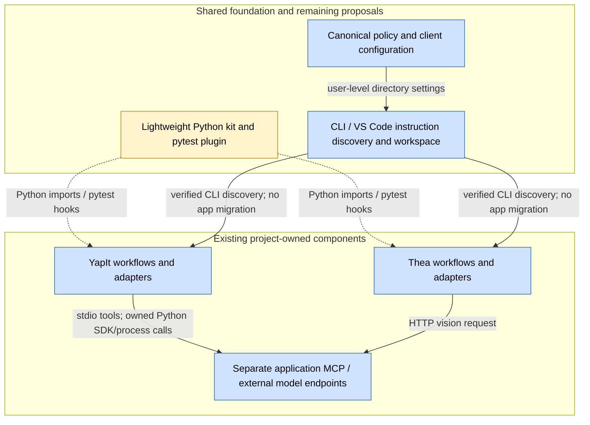
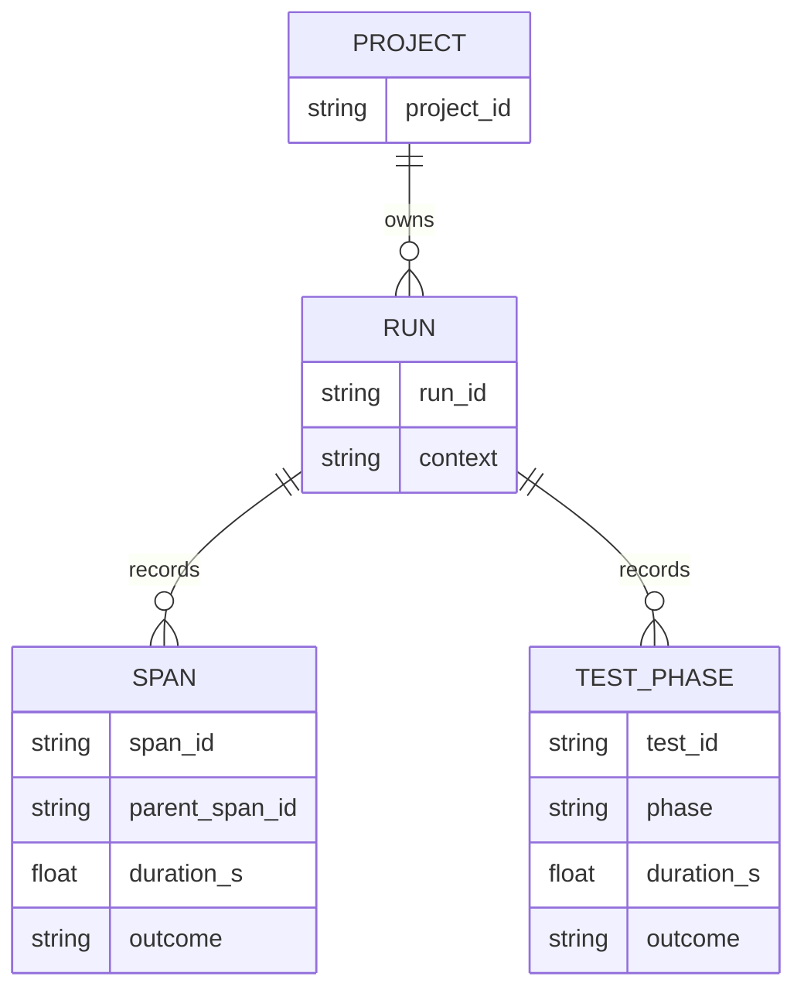

# Shared Development Workspace - YapIt and Thea

| Field | Value |
|---|---|
| Owner | Arka, as the requesting decision owner; implementation ownership not assigned |
| Status | Comparison complete; shared policy/configuration foundation created with approval; application migrations remain proposals |
| Last updated | 2026-11-09 |
| Services in scope | Agent guidance, development tests, local observability, MCP configuration and model-runtime plumbing |
| Reviewers | Project maintainers; additional reviewers not identified |
| YapIt snapshot | `C:\projects\yapit`, `main`, `4decc0f082859cd70ca2489068911b957160bba9` |
| Thea snapshot | `C:\projects\Thea`, `dev`, `666393b9da27a3742ab92fac2009f068f53ffb42` |

**TL;DR:** Use **YapIt as the baseline for enforced development policy, agent-test separation, model lifecycle and minimal telemetry**. Reuse **Thea's useful skills/tasks, validated presets, GPU setup documentation and readable metric summaries**, not its entire editor configuration or fast/slow classification. The approved independent repository is now **`C:\projects\projectWorkspace`**, with shared agent policy, a multi-root workspace, a reusable Git-ignore baseline and opt-in MCP configuration. Keep applications, virtual environments, domain models, actual MCP tools and product documentation independent. A shared Python runtime/test/metrics package remains a proposal; creating instructions does not implement enforcement.

Contents: [Problem](#1-problem-statement), [Implementation and comparison](#2-implementation), [Success criteria](#3-success-criteria), [Remaining work](#4-task-breakdown), [References](#5-reference-links).

## 1. Problem Statement

### Scope and evidence boundary

The comparison covers tracked source/configuration and selected implementation tests at the snapshots above. Both application working trees were clean during the inventory and their HEADs were reconfirmed on November 9. No application files were changed by the workspace setup. No model inference, GPU probing, dependency installation, application test suite, external MCP tool, or benchmark was run. Client instruction-discovery commands were used for the approved setup, not inference. Inventory counts below are static measurements from November 8, not test execution counts.

| Static inventory | YapIt | Thea `dev` |
|---|---:|---:|
| Tracked files | 197 | 97 |
| Markdown under `docs` | 22 | 7 |
| Root README lines | 119 | 383 |
| Root `agenttests/test_*.py` files | 3 | 0 |
| Integration-directory test files | 9 | No equivalent directory; 5 `tests/slow` files |
| Other notable test directories | Module-local tests plus root application tests | 5 `tests/fast` files; 6 `tools/tests` files |
| Central tracked pytest configuration | `pyproject.toml` and root `conftest.py` | No `pytest.ini`, `pyproject.toml`, `setup.cfg`, `tox.ini` or `conftest.py` found in the inspected branch tree |

Source: read-only `git ls-files` / `git ls-tree -r dev` inventory and line counts, November 8. An additional Thea module README lives at `sampled_captioner\README.md`. These counts do not imply that all tests are correctly classified.

### Which implementation is better?

| Area | Better starting point | Evidence and limits | Unified recommendation |
|---|---|---|---|
| Agent instructions | **YapIt for policy; Thea for reusable workflows** | YapIt has focused scoped instructions and explicit rapid/expensive-work rules [Y1]. Thea has a 480-line guide, `.clinerules`, five skills and seven prompts, but assumes capabilities/discovery that are client-specific [T1, T2]. | One canonical standards source; supported client-specific delivery; small per-project overrides. Keep tasks/skills separate from always-loaded policy. |
| Agent-maintenance tests | **YapIt** | Dedicated `agenttests`, automatic marking and non-rapid gating [Y2, Y3]. No equivalent Thea suite was found. Some YapIt checks also exercise user-visible import/workflow guarantees, so not every current test belongs in a universal maintenance bucket. | Shared infrastructure's own functional unit tests run normally. Project doc/catalog/package checks remain opt-in project maintenance checks. |
| Unit versus long tests | **YapIt, with improvements** | Executable rapid/full gates and mocked-process enforcement [Y2]. Thea's folders/tasks express intent, but editor discovery includes `tests` and `tools/tests`; its fast hardware tests invoke real detection and assert GPU availability [T3, T4]. | Shared pytest plugin: safe defaults, explicit expensive-work authorization, pre-import exclusion for expensive modules, and project-specific classification. |
| Lightweight logging/metrics | **YapIt core + Thea summaries** | YapIt provides one decorator, best-effort local JSONL, stderr logging and pytest timings [Y4]. Thea offers in-memory aggregation/table reporting, but also manual pipeline timers, CSV logging and argument-derived context [T5, T6]. | One small runtime package, one run context, safe metadata, sync/async timing, automatic pytest records, optional summary rendering. |
| MCP tooling | **Complementary, not one winner** | Thea configures generic agent-facing servers [T7]. YapIt implements actual application MCP tools, path confinement, busy handling and separate protocol integration tests [Y5]. | Common client recipes/trust guidance; project application servers stay separate. Do not duplicate tools already provided by the active agent. |
| Documentation organization | **YapIt structure; selected Thea setup guides** | YapIt has a short indexed README and paired module user/dev guides [Y6]. Thea has valuable setup material, but more root README detail and a module-local README [T8]. Both have drift. | Shared standards/setup outside applications; project docs remain local; concise decision guide and append-only research remain distinct. |
| Model loading/runtime | **YapIt lifecycle + Thea HTTP adapter route** | YapIt has lazy managed TTS factories/plugins, metadata/cache identity, SDK isolation and a general loader helper [Y7]. Thea has an injectable vision backend calling an external OpenAI-compatible endpoint, not an in-process model loader [T9]. | Share lifecycle/configuration/ownership/transport infrastructure, not one universal inference signature, model environment, speaker state or model output cache. |
| Constants and configuration | **YapIt named defaults + Thea validated presets** | YapIt groups profile/model/path defaults in `src\constants.py`; Thea discovers JSON presets and validates required sections/ranges [Y8, T11]. Thea also tracks a machine-specific `D:/Thea` data path [T11]. | Keep constants with their domain owner, validate user choices at boundaries, document precedence, and keep machine paths out of portable defaults. Do not copy one product's schema into every project. |
| Dependency requirements | **YapIt packaging boundaries** | YapIt has Python bounds, version ranges and optional voice/cloud/ASR/MCP/dev extras. Thea has separate CPU/CUDA/dev manifests, but many base/dev entries are unversioned [Y9, T12]. Neither bounded ranges nor these manifests establish a fully reproducible lock by themselves. | Keep one project manifest/lock workflow; isolate optional heavy stacks and record Python/backend compatibility. Do not install all model SDKs into every project. |
| CPU versus GPU setup | **YapIt runtime isolation; Thea setup-guide organization** | YapIt has mode setup scripts and separate runtime manifests [Y10]. Thea separates CPU/OpenCV CUDA requirements and records its August 3 toolchain; its guide also requires manual edits inside generated `site-packages` [T12, T13]. | Reuse explicit setup profiles and dated evidence, not universal CUDA versions or manual vendor-file patching. Keep incompatible environments separate and GPU checks opt-in. Thea's documented GPU result was not rerun here. |
| Functional modularity | **Both, at task boundaries** | YapIt provides managed TTS adapters/SDK isolation; Thea exposes an injectable vision protocol and distinct processing modules [Y7, T9]. These are concrete boundaries, not a measured ranking of all code quality. | Prefer pure transformations, dependency injection and clear I/O/runtime ownership; avoid arbitrary function limits and universal application APIs. |
| Feature requirements and docs lifecycle | **YapIt concise decisions; Thea explicit backlog** | YapIt's indexed guides/current analysis and Thea's `productionize.todo.md` serve different needs [Y6, T8]. A backlog is not proof of implementation, and research is not an executable acceptance test. | Keep accepted scope/criteria in project docs/issues; distinguish current decisions, proposed work and append-only evidence. Keep dependency manifests separate from product requirements. |

### Gaps and why they exist

- **G1 - Policy duplication and discovery drift.** Thea's infrastructure evolved around Cline, local LLMs and editor tasks; YapIt added explicit rapid development and SDK isolation. Their rules now overlap, but Thea's `.instructions.md` claims `.vscode\skills` discovery and broad cross-agent applicability. Current official support depends on the actual agent harness; the old configurable skill location is compatibility machinery, not a universal native location [T1, E1, E2].
- **G2 - Folder names do not enforce test safety.** Thea's "Run Fast Tests" omits all six `tools/tests` files, including useful application/storage tests, while its editor/full selection includes slow tests. `tests\fast\test_hardware.py` calls `detect_hardware`; the implementation calls OpenCV CUDA detection and can select GPU device zero [T3, T4]. YapIt's post-collection gates are stronger but do not prevent expensive top-level imports before the marking hook runs [Y2, E4].
- **G3 - Observability is duplicated and not fully run-isolated.** Thea mixes decorators, explicit timers, CSVs and a global collector. Its function-duration sum is not elapsed pipeline wall time when spans nest. YapIt's JSONL writer is simpler, but its lock is process-local and independent runs reset shared paths; that is not a robust cross-process/multi-run storage contract [Y4, T5, T6].
- **G4 - Tool infrastructure and application MCP are conflated.** Thea's four configured generic servers are not a Thea video-processing MCP API. YapIt is the stronger application-tool implementation. Client JSON formats and global/workspace activation differ [Y5, T7, E3].
- **G5 - Docs can drift even with good layout.** YapIt's root developer guide still describes CosyVoice as paused, while its newer adapter/analysis guide describes working integration [Y6, Y7]. Thea's skill lists generated documents not all present in the branch inventory; its setup guide mixes coding-agent LLM configuration with MCP/application setup [T8]. Do not mistake a generation plan for delivered documentation.
- **G6 - A shared person or model name is not a shared runtime.** YapIt's audio adapters and Thea's vision HTTP adapter have different data contracts and resource ownership. Thea's agent Qwen configuration is also a different role from a multimodal captioning model. Sharing virtual environments or blindly sharing KV/voice tensors would break the intended isolation [Y7, T9].

**Standards:** preserve user-visible behavior, cheap functional tests and correctness gates. Asking for analysis is not permission to implement it. Expensive tests/inference require explicit authorization. The user's clarified generation semantics are **retrigger means a fresh attempt**, not replaying saved speech; the existing YapIt worker cache is a current project-specific behavior, not something to silently standardize or change here.

Concerned areas are the two project maintainers and the owner of the proposed shared kit. No separate teams, Microsoft aliases or on-call rotations were identified; none are invented or required for this personal-workspace proposal.

## 2. Implementation

### 2.1 One shared kit, not a monorepo or global virtual environment

**Foundation created on November 9; application directories remain independent:**

```text
C:\projects\
  projectWorkspace\
    .git\                      separate local Git repository, main branch
    .github\instructions\      canonical shared policy
    .vscode\mcp.json            opt-in editor MCP baseline, no extra servers
    mcp\copilot.json            optional CLI MCP baseline, no extra servers
    AGENTS.md                  shared-repository context
    .gitignore                 reusable baseline, not inherited by siblings
    projectWorkspace.code-workspace
    README.md                  short guide index
    docs\                      standards, setup, MCP and this comparison
  yapit\                       independent application repository
  Thea\                        independent application repository, dev branch
```

The owner approved live user-level policy discovery for **Copilot CLI and VS Code Copilot**, with built-in tools first and no extra MCP servers. CLI configuration adds the canonical instruction directory to the user's `COPILOT_CUSTOM_INSTRUCTIONS_DIRS`; VS Code adds that directory to `chat.instructionsFilesLocations`, preserving existing settings. CLI discovery was verified from both applications with the shared policy enabled. VS Code's setting is configured; interactive UI application still requires reload/inspection. See `docs\dev.readme.md` for checks and rollback [W1, E1, E2].

The Git origin is the user-provided `https://github.com/Arka95/projectWorkspace.git`; adding it does not create a commit or push, and Git URL rewriting/authentication remain separate concerns. No application dependency/runtime package, pytest plugin, shared logger, generated project adapter, model broker or test migration was installed. The owner clarified that **only the diagram reference inside the source techlead skill is owned and authorized for copying**. The standalone `techdiagrams` entry point exposes only that file; the copied template, derived techlead skill and earlier personal registrations were removed [W2].

For any later executable library, choose a **versioned package with pinned adoption per project**. This costs a small release/update step, but avoids one application becoming another's dependency and avoids silently changing runtime behavior when a shared file changes. Editable installs are acceptable during explicitly coordinated development; stable projects should consume a recorded version. This is distinct from the owner's deliberately live shared personal policy.

Do not use symlinks as the mandatory Windows integration mechanism. Do not assume opening `C:\projects` causes every repository to inherit a parent `conftest.py` or instruction file. Pytest has config/root boundaries; agents have client-specific discovery rules [E1, E2, E4].



**Backed by:** existing boundaries [Y5, Y7, T7, T9] and approved policy/configuration files [W1]. Blue/solid = existing foundation or project boundary; yellow/dashed = proposed runtime package. Solid policy arrows mean discovery, not enforcement or completed runtime adoption. Only the owner-authorized diagram guide is imported [W2]; a wider independently authored template/workflow catalog remains future work.

**Policies/configuration:** own language-neutral permission, testing, documentation and model-operation rules. They communicate at discovery time through reviewed files and supported personal instruction locations, not a runtime service. The diagram guide is available on demand; no source techlead/template content is retained.

**Python kit/plugin:** provides synchronous imports for metrics/model-transport helpers and pytest hooks for collection/reporting. It does not import model SDKs at package import time or introduce an always-on server.

**Client/workspace discovery:** points both selected clients at one policy source and groups editor roots. Each project retains its own interpreter and state. CLI availability was inspected directly; a GUI reload/inspection is still needed for VS Code. Optional MCP config uses each client's distinct format and starts no extra server.

**YapIt:** retains voice enrollment, scripts, TTS adapters, training, rendering and its stdio MCP application API. It imports shared infrastructure only at a stable boundary.

**Thea:** retains optical flow, contact-sheet sampling, captions, video metadata/storage and output rules. Its external model endpoint calls remain HTTP requests; they do not become shared TTS calls.

**Application servers/endpoints:** remain separately named and owned. Shared configuration may reference them; closing an HTTP client must not unload or stop a model server somebody else owns.

### 2.2 Agent instructions and agent tests

Use a small canonical policy set: permissions, Python development, test classification, diagnostics/privacy, model operations and documentation lifecycle. Put GPU/VPN/feed paths, Arka preferences and editor taste in **personal/machine configuration**, not universal library policy or copied app READMEs.

Deliver shared policies through supported personal locations, a reviewed agent plugin, or explicitly generated client-specific files. Copilot CLI supports personal instruction directories and `COPILOT_CUSTOM_INSTRUCTIONS_DIRS`; its reference lists supported sources. VS Code supports project instructions such as `.github\copilot-instructions.md` / `AGENTS.md`, with harness-specific activation [E1, E2]. A Markdown link alone is not a guaranteed transitive import. Verify discovery with the actual client's instruction/customization inspection UI.

Reuse Thea's useful skill/task content after removing repo paths, unavailable-tool assumptions, arbitrary function-length/one-assertion rules and unconditional full-suite instructions. Prefer supported native skill locations over relying on `.vscode\skills` forwarding [T1, E2].

Separate tests by **purpose**, then by **cost**:

| Category | Examples | Default |
|---|---|---|
| Application functional unit | Configuration behavior, parsing, mocked model selection, timing result/error preservation, fake caption requests, SQLite in-memory behavior | Run; no real network/GPU/model/subprocess |
| Agent maintenance | README command catalog synchronization, instruction/frontmatter validation, packaging/document layout checks | Explicitly selected development/CI maintenance lane |
| Integration / slow | Real FFmpeg/video workflows, stdio MCP handshake, actual hardware discovery or offline dataset/library integration | Skip by default; explicit opt-in |
| Model / GPU | Loading weights, local or cloud inference, training, performance/memory probes | Skip by default; explicit expensive-work opt-in |

Do **not** classify Thea's config/storage tests as agent tests just because agents use them. Likewise the shared kit's own timing/plugin tests are functional tests of that package and should run normally. Lazy-import/model-free startup is a real runtime guarantee; keep that guarantee tested in an appropriate cheap unit or deliberate boundary integration test, rather than hiding it as mere doc maintenance.

Extract YapIt's gate logic into a reusable optional pytest plugin, adding:

- Pre-import collection exclusion for expensive test directories when not authorized; marker checks remain defense in depth.
- Independent `agent`, `integration`, `slow` and `model` classifications; a slow test need not be a model test.
- A general network/process/model guard with explicit mock boundaries. YapIt's current three patched entry points are useful but not a complete sandbox.
- Per-project configuration for test paths and legacy classification. Migrate Thea's hardware tests to mocks for logic and opt-in integration for physical detection.
- CI cheap functional tests on every change, selected cheap maintenance/build checks as a separate lane, and expensive workflows only in explicitly configured lanes. Skipping must not conceal required release validation.

No Thea or YapIt test runner configuration is changed by this report or the foundation setup. The policy records the desired default, but extracting enforcement remains proposed.

### 2.3 Logging and metrics with minimal integration code

Start from YapIt's best-effort `@timed`, stderr logging and safe exception-type records. Add Thea's optional readable summaries, not its argument-capturing lambdas, duplicated timers or CSV domain coupling [Y4, T5, T6].

**Proposed integration contract:** one application-entry initialization/run scope plus a decorator on meaningful operations. Pytest's plugin initializes its own scope automatically. "Zero boilerplate" means no per-call timer, file writer or report dictionary; it cannot mean zero boundary configuration while still knowing the project/job.

Required behavior:

- Standard-library-only runtime core; support the actual Python 3.10 isolated SDK and 3.11/3.12 application constraints. Optional pytest/MCP/model extras must not pull Torch or GPU stacks into every application.
- Sync and async execution timing, preserved signatures/results/exceptions/cancellation, and negligible work at operation boundaries.
- Stdout reserved for application/MCP protocol output; diagnostics on stderr. Thea currently logs to stdout [T6].
- No arguments, narration, images, filenames, credential values or exception messages by default. Allowlist explicitly supplied metadata; record error type.
- Run IDs and per-process files; a child inherits the parent run ID. Process-local locks alone do not make a shared file multi-process safe.
- Each project has `.repo-stats` ownership; maintain a small atomic latest-run index instead of clearing other active runs' files. Completed-run retention is bounded and configurable.
- Summaries distinguish **wall time** from accumulated/nested span time. Never report the sum of nested calls as pipeline latency.
- Application-specific video CSV/business metadata remains Thea's responsibility.

Illustrative record fields are **proposed**, not the current common schema:
`project`, `run_id`, `span_id`, `parent_span_id`, `pid`, `module`, `operation`,
`duration_s`, `outcome`, `error_type`, `context`.



**Backed by:** existing function/test/run records [Y2, Y4], Thea metric records [T5], and this section's explicitly proposed run/span isolation. This is a logical file-record model, not a new database schema.

### 2.4 MCP and model loading

Maintain one reviewed MCP recipe inventory; emit the appropriate client configuration. Thea's VS Code file uses `servers`; portable configurations use `mcpServers`. Current official guidance also distinguishes Copilot-global configuration and compatibility-oriented VS Code workspace configuration. Do not claim one JSON file works unchanged in every harness [T7, E3].

Only enable capabilities actually missing from the active agent. Do not automatically install filesystem/git/memory/reasoning MCP servers if built-in tools already suffice. Review and pin packages/commands rather than copying unversioned `npx -y` recipes blindly. Paths, credentials and trust remain local; no package stores credentials.

For model infrastructure, extract the **small common envelope** from YapIt:

- Backend/provider identity, explicit model/revision, capability metadata and isolated dependency/runtime selection.
- Lazy construction, explicit preparation/load where applicable, deterministic owned-resource cleanup and clear failure behavior.
- Model/cache-root configuration, safe transport, timing and effective-device metadata.
- Separate task contracts: speech synthesis, vision captioning, ASR and agent chat remain separate APIs.
- Distinguish **managed local SDK**, **owned isolated process** and **external HTTP endpoint**. Thea's HTTP client normally owns neither server weights nor server lifetime.

Do not turn `load_model(loader, ...)` into a universal neural engine; today it only supplies cache-root arguments and timing [Y7]. Do not unify virtual environments: CosyVoice's stack conflicts with the application runtimes. Do not move voice consent, text fidelity, acoustic normalization, caption prompts or optical-flow configuration into the shared kit.

Prepared profile caches must be backend/model/revision/preprocessor-specific. Whole-output caching is not a universal inference feature: the user's repeated generation request means fresh inference. Changing the existing YapIt worker cache semantics requires a separately authorized application change.

### 2.5 Documentation ownership

| Keep in shared-kit docs | Keep in each application's docs |
|---|---|
| Development/testing standards, diagnostics schema, client setup patterns, reusable MCP recipes, model-runtime ownership, machine setup profiles | Product purpose, commands, voice/video workflows, application data, model acceptance/quality evidence, domain configuration and module guides |

Use a concise root README with a docs index, then `docs\dev.readme.md`, setup guides where justified, module user/dev guides and current decision notes. Root instruction files required by a client are deliberate tooling exceptions to "README only at root"; do not bury discoverable instructions in ordinary docs.

Keep YapIt's research append-only and outside compaction. Shared docs should describe common policy, not absorb or rewrite project research archives. Thea's productionization backlog and generated-doc plan are historical/proposed until validated against code. Do not copy their stale TODOs as implementation requirements.

First application drift fixes remain proposals: reconcile YapIt's paused-CosyVoice statement; reduce Thea's root guide/README duplication; identify missing planned docs; update skill discovery guidance; distinguish coding-agent model setup from the actual vision caption endpoint [Y6, T1, T8, T9]. Only this workspace's documentation was created.

### 2.6 Constants, requirements, modularity and device setup

**Keep doing:** YapIt's explicit named defaults, bounded package metadata and optional dependency groups; Thea's preset discovery, aggregated validation errors, CPU/CUDA manifests and separately indexed system-tool guide [Y8, Y9, T11-T13]. These address different layers and should be combined as conventions rather than merged into one product configuration.

**Gaps/tradeoffs:** `models_directory()` in YapIt combines cache resolution with directory creation, so it is an effectful boundary, not a pure constant accessor [Y8]. Thea tracks a machine-specific data root, its base/dev dependency lists mostly omit versions, and its GPU guide requires editing generated OpenCV loader files [T11-T13]. The August 3 GPU toolchain is dated project evidence, not a current recommendation or a universal setup for PyTorch/TTS. No package compatibility or hardware test was rerun for this report.

**Chosen policy:** name domain constants near their owner; parse and validate user settings once at boundaries; pass explicit configuration to pure logic; document precedence without changing existing defaults. Keep product acceptance requirements in local issues/docs, dependency requirements in the existing manifests/locks, and machine secrets/paths in local configuration. Preserve project-specific configuration and avoid global mutable state/config dumps.

Use separate project-owned environments when CPU/GPU/vendor dependencies conflict. Record requested and effective device/dtype, runtime compatibility and server ownership. Do not add hardware probes to a unit test or automatically install CUDA during coding. Shared setup conventions are implemented as policy [W1]; package extraction, reproducible locks, device setup and changes to either application remain explicitly unimplemented.

### 2.7 Scale, storage and failure behavior

**Measured scope:** two application repositories, one requesting workspace owner, 29 Markdown documents under their `docs` trees (`22 + 7`). No aggregate suite latency, instrumentation overhead or request-rate baseline was measured.

**Sizing example, not measured traffic:** assume two simultaneous processes, each recording 20 operation/test events per second, at 1 KiB per event. Peak write rate is `2 x 20 = 40 events/s`, approximately `40 KiB/s`. Ten active minutes produce `40 x 600 x 1 KiB = 23.4 MiB`. Retaining three runs of that size is about 70.3 MiB; use a configurable byte cap rather than assuming workloads remain this small. A ten-second report refresh is 0.1 read request/s per viewer. Log only operation boundaries, not individual model tokens/video frames.

**Backpressure:** synchronous local writes must not become token/frame-loop I/O. Bounded records and per-process files avoid a central multi-process writer bottleneck. If persistence is unavailable, diagnostics degrade without blocking inference or changing its exception. Expensive test work is excluded before fixtures/imports when possible. Model contention should use explicit project-owned admission/lifetime policy; no new GPU broker is proposed.

<table>
  <thead><tr><th>StorageTypeName</th><th>UseCases</th></tr></thead>
  <tbody>
    <tr style="background-color:#90EE90;color:#000000">
      <td>Single-host local files: JSONL plus atomic run index</td>
      <td>Chosen for lightweight disposable diagnostics, following YapIt's local-file precedent. CA shorthand applies only to this unpartitioned single-host design; no replicated availability or cross-host consistency guarantee is claimed. No database/queue service is required.</td>
    </tr>
    <tr style="background-color:#90EE90;color:#000000">
      <td>SQLite, single-host - existing Thea application store</td>
      <td>Keep video/application metadata local to Thea. Its connection lock and WAL support local access; do not reuse it as a mandatory shared telemetry service. CA shorthand excludes network-partition/failover claims.</td>
    </tr>
  </tbody>
</table>

Legend: Light-Green = CA in the single-host convention; AP/CP are not proposed. CAP concerns distributed consistency versus availability under partitions; these local choices do not create a distributed storage system. **Why chosen:** diagnostics are small, disposable and offline; application SQLite data has a different lifecycle [Y4, T10].

| Single point of failure | Impact | Mitigation |
|---|---|---|
| Shared policy/package release | Bad release could affect adopted projects | Pin versions; canary one project; test the kit independently; roll back adoption |
| Local diagnostics disk/index | Lost metrics or stale latest pointer | Best-effort writer, atomic index, bounded retention; application still works |
| Client-specific instruction discovery | Rules appear available but are not applied | Inspect actual harness discovery and test activation; no assumed parent-folder inheritance |
| Model environment/external endpoint | Inference fails or device is unavailable | Preserve dependency isolation and explicit ownership; fail clearly; never silently change requested backend/device |

Useful local views: run wall-time bars for before/after comparisons; per-operation latency distributions for regression diagnosis; outcome-count bars for test gates; stage proportions for load versus generation cost. Percentiles require sufficient observations, and nested spans must not be added as independent wall time.

## 3. Success Criteria

| Requirement | Baseline | Acceptance target / guardrail |
|---|---|---|
| Shared policy ownership | Repeated rules in project-specific files [Y1, T1] | One versioned source per common rule; deliberate documented project overrides; verified supported delivery in chosen clients |
| Default test safety | YapIt guards; Thea fast hardware detection [Y2, T4] | Zero real model/GPU/network/process work in default unit mode; cheap functional tests run rather than being skipped |
| Expensive lanes | YapIt executable opt-ins; Thea folder/task convention | Explicit opt-in for slow/integration/model lanes; expensive imports excluded where practical; all skips reported |
| Maintenance classification | YapIt has a suite; Thea does not | Maintenance tests isolated; application contract tests not hidden; shared-kit functionality tested normally |
| Metrics integration | Two decorators plus manual Thea timings/CSV [Y4, T5, T6] | One shared decorator/run scope; automatic pytest phase/run reporting; no per-operation writer/timer boilerplate |
| Metrics correctness/privacy | YapIt safe fields; Thea context/error messages | Return values/errors unchanged; no secrets/raw media/narration; concurrent runs cannot erase/interleave each other's records |
| Instrumentation overhead | Not measured | Measure first with fake workloads; agree a budget before rollout; keep it outside token/frame loops |
| MCP | Generic editor config versus application API | Each client format validated; least required tools enabled; server ownership and path/auth policy explicit |
| Model infrastructure | TTS lifecycle versus HTTP vision interface | Common envelope, separate task APIs/environments; no universal voice/KV tensor or implicit generation-output replay |
| Documentation | 22 versus 7 docs; known drift | Clear common/project ownership; corrected current guides; append-only archives preserved byte-for-byte |

**Foundation exit:** independent Git repository and origin; indexed shared policy covering all requested topics; separate MCP client schemas with zero extra servers; user-level CLI/VS Code discovery configuration; enabled policy discovered from both application roots; application files/branches preserved. VS Code UI discovery remains a manual reload/inspection check, not a claimed automated result.

**Future runtime-adoption exit:** both projects adopt a selected shared-library version without domain behavior changes, default unit checks remain useful and safe, and explicitly selected integration/model tests retain their original purpose. No claimed speedup is accepted without a measured comparable workload.

## 4. Task Breakdown

The lightweight policy/configuration foundation was authorized and created separately; it is not a one-to-two-week migration. **Remaining tasks below are proposals.** Estimates include runtime implementation, both-project migration and validation; each is approximately one to two weeks, not a claim that creating a file alone takes that long.

| ID | Deliverable | Dependencies | Acceptance |
|---|---|---|---|
| WK-1 | Extend the completed policy foundation with runtime-package ownership/versioning and reconcile project rule conflicts (G1/G6) | Existing foundation | Approved executable-library boundaries and pinned adoption design; no mandatory shared environment |
| WK-2 | Extract and test safe pytest modes/collection guards; classify Thea fast/tools/slow tests and both maintenance lanes (G2) | WK-1 | Mocked hardware unit coverage, explicit slow/model opt-in, no loss of cheap functional tests |
| WK-3 | Build shared safe diagnostics from YapIt's writer/decorator and Thea's summaries; add run/process isolation and async support (G3) | WK-1 | Fake concurrent-run tests, privacy/error preservation, optional reports, measured overhead |
| WK-4 | Consolidate reviewed skills/tasks and MCP recipes; verify supported discovery/configuration for chosen clients (G1/G4) | WK-1 | Tested client-specific activation, no unavailable-tool promises or unowned daemon operations |
| WK-5 | Extract SDK-independent model lifecycle/transport/config helpers and prototype TTS versus HTTP-vision consumers (G6) | WK-1, WK-3 | Mock-only contract tests first; keep task schemas, environments and resource ownership separate |
| WK-6 | Pilot pinned adoption, reconcile docs drift and publish rollback/release checks (G5) | WK-2, WK-3, WK-4, WK-5 | Both projects still independent; append-only research preserved; no runtime/default behavior migration without approval |

Initial priority is WK-1/2, then WK-3. Model abstraction and richer MCP orchestration are later: standardizing safe development and diagnostics gives broader reuse than building a universal inference service.

## 5. Reference Links

Paths below are relative to the named snapshot roots. Line ranges identify the inspected implementation; documentation plans are not treated as deployed components.

### YapIt

- **[Y1]** `.github\instructions\python-and-testing.instructions.md:5-98`; `.github\instructions\dependency-management.instructions.md`; `.github\instructions\model-analysis.instructions.md:5-27`.
- **[Y2]** `conftest.py:15-58,62-116`: options, post-collection classification, process/network guard, session statistics. `pyproject.toml`: pytest markers/testpaths and optional dependencies.
- **[Y3]** `agenttests\test_packaging.py:8-78`; `agenttests\test_import_boundaries.py:6-96`; `agenttests\conftest.py`: actual maintenance/boundary checks. `.github\workflows\ci.yml`: Linux/Windows Ruff, default pytest and build.
- **[Y4]** `src\common_utils\metrics.py:20-126`; `src\common_utils\tests\test_metrics.py:15-115`: best-effort JSONL, reset semantics, decorator and result/error/privacy tests.
- **[Y5]** `src\mcp\server.py:24-176`; `src\mcp\tests\integration\test_server.py`; `src\mcp\tests\test_tools.py`; `docs\mcp\dev.readme.md`: project MCP registration and protocol boundaries.
- **[Y6]** `README.md:1-119`; `docs\dev.readme.md:1-55,130-140`; `docs\yapper\dev.readme.md`; `docs\analysis.md`: index, module ownership, stale paused-CosyVoice statement versus newer integration guide.
- **[Y7]** `src\yapper\backends.py:19-101`; `src\yapper\isolated.py`; `src\yapper\isolated_runtime.py`; `src\yapper\cosyvoice.py`; `src\common_utils\modelutils.py:13-24`; `src\rescript\transcription.py:63-79`; `src\yapper\worker.py:172-195,225-227`.
- **[Y8]** `src\constants.py:1-19`: named defaults, environment-backed model-root resolution and explicit directory creation.
- **[Y9]** `pyproject.toml:1-37`: Python constraint, bounded dependencies, optional backend/dev groups and entry points.
- **[Y10]** `scripts\setup-mode.py`; `scripts\setup-mode.cmd`; `requirements-cpu.txt`; `requirements-gpu.txt`; `requirements-cosyvoice.txt`; `scripts\cosyvoice-runtime.requirements.txt`: tracked setup/runtime separation; not executed for this comparison.

### Thea `dev`

- **[T1]** `.instructions.md:1-65,160-207,376-400,439-480`; `.clinerules`: instruction/discovery claims, workflow policy and tool assumptions.
- **[T2]** `.vscode\skills\document-generator\SKILL.md:15-100`; `.vscode\prompts\test-writer.md`; tracked skill/prompt inventory.
- **[T3]** `.vscode\tasks.json:1-63`; `.vscode\settings.json:1-44`: fast/full commands, editor discovery and skill locations.
- **[T4]** `tests\fast\test_hardware.py:12-35`; `utils\hardware.py:50-59,90-104`: real detection, GPU assertion and device selection.
- **[T5]** `utils\metrics.py:39-159,169-256`: structured records, global collector, aggregates, decorator and context/error behavior.
- **[T6]** `main.py:45-53,295-353,501-504`; `utils\pipeline_logger.py:1-137`; decorators in `downscaler\downscaler.py:21`, `motion_assessment\analyzer.py:28,134`, `slicer\slicer.py:99`.
- **[T7]** `.vscode\mcp.json`: four generic servers and VS Code schema; `requirements-mcp.txt`.
- **[T8]** `readme.md`; `docs\setup.local-llm-mcp.md`; `docs\productionize.todo.md`; `sampled_captioner\README.md`; static branch docs inventory.
- **[T9]** `sampled_captioner\captioner.py:29-34,67-139,142-176`: task protocol, HTTP endpoint client and injected workflow.
- **[T10]** `tools\storage\sqlite_store.py:52-74`; `tools\tests\test_memory_store.py`; `tools\tests\test_sqlite_store.py`; `tests\fast\test_config_loader.py`; `tools\tests\test_geocoding.py`: domain storage/configuration versus optional real offline-library tests.
- **[T11]** `utils\config_loader.py:1-153`; `config\settings\settings.json:1-5`; tracked `config\presets` inventory: discovery, required-section/range validation and a machine-specific data path.
- **[T12]** `requirements.txt`; `requirements-cpu.txt`; `requirements-cuda.txt`; `requirements-dev.txt`: base/dev entries, selected OpenCV pin and wheel URL. CUDA compatibility comments are recorded project claims, not independently revalidated hardware results.
- **[T13]** `docs\setup.gpu.md:1-156`: separate acceleration selection, August 3 toolchain record and generated OpenCV loader modification instructions. No system setup or probe was performed here.

### Shared foundation created with approval

- **[W1]** `C:\projects\projectWorkspace`: `AGENTS.md`, `.github\instructions\workspace.instructions.md`, `.gitignore`, `projectWorkspace.code-workspace`, `.vscode\mcp.json`, `mcp\copilot.json`, `README.md`, `docs\dev.readme.md`, `docs\standards.md`, `docs\mcp.md`. User environment and VS Code user settings point to the instruction directory; CLI `instruction list --json` from YapIt and Thea found the shared source with `defaultDisabled: false`. These changes do not install runtime enforcement.
- **[W2]** `.github\skills\techdiagrams\SKILL.md`, `.github\skills\techdiagrams\references\diagrams.md`, `docs\skills.md`: the sole owner-authorized source file plus a locally written discovery wrapper. The reference is retained byte-for-byte, not a copy of the source techlead skill or template. Personal discovery points only to the techdiagrams folder; no additional MCP service is needed. The previously imported/derived non-diagram material and earlier registrations were removed before any commit or push.

### Official guidance verified during the investigation

- **[E1]** Copilot CLI authoritative help/reference, installed version 1.0.107, retrieved with the CLI documentation tool. Supported instruction sources and `COPILOT_CUSTOM_INSTRUCTIONS_DIRS`; `.github` resources are not universally inherited from any ancestor.
- **[E2]** https://code.visualstudio.com/docs/agent-customization/custom-instructions and https://code.visualstudio.com/docs/agent-customization/agent-skills : current harness-specific locations, activation verification and compatibility skill locations.
- **[E3]** https://code.visualstudio.com/docs/agent-customization/mcp-servers : global/workspace destinations, `servers` versus `mcpServers`, trust and configuration differences.
- **[E4]** https://docs.pytest.org/en/stable/how-to/writing_plugins.html and https://docs.pytest.org/en/stable/example/markers.html : plugin loading, configuration boundaries and marker selection.
- **[E5]** https://code.visualstudio.com/docs/editing/workspaces/multi-root-workspaces : editor grouping and workspace configuration.
- **[E6]** https://docs.github.com/en/copilot/how-tos/copilot-cli/customize-copilot/add-custom-instructions and https://code.visualstudio.com/docs/agents/reference/custom-instructions-reference : additional CLI directories, additive instruction behavior and editor search locations. https://code.visualstudio.com/docs/agents/reference/ai-settings documents `chat.instructionsFilesLocations`. Rechecked November 9 for client activation.

No dashboard, peer-company telemetry, PR evidence or M365/on-call data was used or assumed. Outstanding work is the explicitly proposed compatibility/overhead/adoption validation in WK-1 through WK-6.
